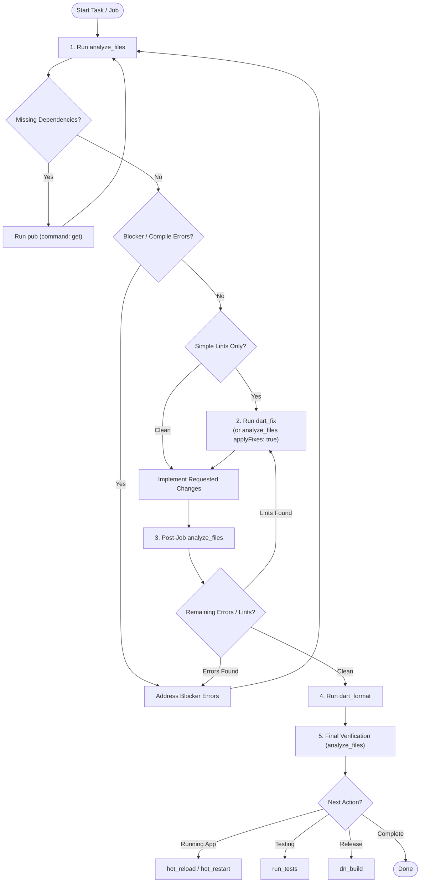

# DartNative MCP Skill

The `dartnative` MCP server exposes the DartNative `dn` CLI, the Dart analyzer, and the Dart Tooling Daemon (DTD) to your agent. Always prefer these tools over running shell commands.

This skill is organized modularly using progressive disclosure. Consult the dedicated reference guides in [`references/`](./references/) for deep dives into specific subsystems.

---

## 1. Core Principles & Mandatory Rules

### Rule 1: Always Start With Analysis (`analyze_files`)
- **Initial Action**: The analysis command (`analyze_files` or `dn_analyze`) **must always be the first action** taken when starting work on a codebase, task, or bug fix.
- **Diagnostics First**: Never edit files blindly. Run `analyze_files` to surface:
  - Missing dependencies (e.g. `uri_does_not_exist` or unresolved imports).
  - Syntax errors, type mismatches, and unresolved references.
  - Active warnings and lints.
- **Dependency Resolution**: If missing package dependencies are reported, immediately call `pub` with `command: "get"` before proceeding.
- *Full Guide*: See [`references/analysis_and_formatting.md`](./references/analysis_and_formatting.md).

### Rule 2: Auto-Fix Simple Lints with `dart_fix` (Never Edit Manually)
- When analysis returns no blocker errors but has simple lints, style issues, or automated fix candidates (e.g., deprecated syntax, unnecessary `new`/`const`, import sorting):
  - **Do NOT manually edit files one by one.**
  - **Use `dart_fix`** (or call `analyze_files` with `applyFixes: true`) to resolve them automatically across the project.
- Only manually edit files when human architectural or logical decisions are required.
- *Full Guide*: See [`references/analysis_and_formatting.md`](./references/analysis_and_formatting.md).

### Rule 3: Always Analyze & Format After Every Job
- After completing code modifications, bug fixes, or feature implementations:
  1. **Re-run `analyze_files`**: Confirm that all targeted issues are resolved and no regressions or new warnings were introduced.
  2. **Run `dart_format`**: Ensure all modified files and project roots conform to official Dart formatting rules.
- *Full Guide*: See [`references/analysis_and_formatting.md`](./references/analysis_and_formatting.md).

### Rule 4: Only `dn` and `dart`
- DartNative projects are built and managed with `dn`; analysis, automated fixes, and formatting use `dart`.
- Do not invoke foreign SDK CLIs (such as `flutter`). Use the matching MCP tool instead of running shell commands whenever one exists.

### Rule 5: Search Before You Add
- Never guess a package name. Find it first:
  - Native capability (camera, sheet, permissions, maps) → `dartpub_search` (DartNative plugin registry on dartpub.dev).
  - Ordinary Dart package (`http`, `path`, `json`) → `pub_dev_search` (pub.dev).
- `dartpub_search` does **not** search pub.dev packages; `pub_dev_search` does not search DartNative plugins.
- Read the plugin's `readme` with `detail: "readme"` before writing integration code, then install with `pub` `command: "add"` and `packageNames`.
- *Full Guide*: See [`references/pub_search.md`](./references/pub_search.md).

### Rule 6: Check the Fast Launch Path Before Building
- **Before every `dn_run` that may build**, inspect whether a compatible debug application binary already exists. Do not start a fresh native build until you have checked this.
- Read [`references/fast_run_without_build.md`](./references/fast_run_without_build.md) and use `useApplicationBinary` when the binary exists, is for the requested device type (simulator vs physical device), supports hot reload, and no native/dependency inputs have changed since it was built.
- If compatibility cannot be established, or any native input is newer than the binary, do a normal `dn_run` build and state why the fast path was rejected.
- *Fast decision guide*: [`references/fast_run_without_build.md`](./references/fast_run_without_build.md).

### Rule 7: Give Build Status Before and After the Operation
- Before a potentially expensive launch/build, tell the user which mode will be used: **full native build** or **prebuilt fast launch (build skipped)**, and the reason. Ask a concise question first if the app root, device, flavor, or binary compatibility is genuinely ambiguous.
- After an app launch, use a **single simple line** for full-vs-fast mode; include the device name and total elapsed time. Report the `ideAttach` result. Put only the exact VM Service WebSocket URL in its own fenced copy box, and render the exact debugger/DevTools URL as a Markdown link. Fetch logs if needed; never fabricate or repeat stale URLs. If no app was launched (for example, `dn_build` only), state that runtime URLs are not applicable.
- Summarize recoveries only when verified. Prefer the build duration printed by Xcode/`dn`; otherwise measure wall-clock time from operation start to `ready: true` and label it as total time.
- *Full procedure and response format*: [`references/simulator_run_workflow.md`](./references/simulator_run_workflow.md).

---

## 2. Standard Workflow Lifecycle

---

## 2.5 Running on a Simulator or Device

To launch and iterate on an iOS simulator or Android emulator, follow the
dedicated end-to-end workflow in
[`references/simulator_run_workflow.md`](./references/simulator_run_workflow.md).
Condensed sequence:

1. `analyze_files` → run `pub` `"get"` and re-analyze if dependencies are missing.
2. `dn_devices` → pick the iOS simulator / Android emulator device ID (a concrete ID from the list — `dn_run` does not accept a bare platform name like `ios`).
3. Resolve the app root and target, then **check for a compatible prebuilt debug binary before launching**. Use the fast path whenever it passes compatibility checks; only otherwise do a full build.
4. Tell the user the chosen mode and why; then run `dn_run` with `root` + `device` (+ `target`, raised `timeout` on a full first build). The result includes the app's VM Service URI; the server connects it automatically and uses `.dart_tool/dartnative_dtd.json` to ask the open IDE to attach its debugger.
5. Verify the automatic IDE attach status in the `dn_run` result. For an app launched elsewhere, use `attach_ide_debugger` with the project root and VM Service URI (or let it discover the single VM service registered with the IDE DTD). Report the VM Service and debugger URLs.
6. Iterate: edit → `analyze_files` → `hot_reload` (or `hot_restart` for init/state changes) → `get_runtime_errors` + `dn_app_logs`.
7. `dn_stop_app` with the returned `pid` when finished.

**Fast path is the preferred path for repeat launches.** It is not enough to
know that `useApplicationBinary` exists: verify the artifact is present, is a
debug build for the requested simulator/device, and is fresh against native
and dependency inputs. Then pass it to `dn_run`; Dart-only changes can be
synced without repeating the native build. If any check is unknown, use the
full build rather than risk launching an incompatible artifact. Follow the
step-by-step gate in [`references/fast_run_without_build.md`](./references/fast_run_without_build.md).

---

## 3. Modular Reference Guides

Detailed instructions, schemas, parameter tables, and tool recipes are separated into modular guides:

| Reference Guide | Topics Covered | Key Tools |
| :--- | :--- | :--- |
| [`analysis_and_formatting.md`](./references/analysis_and_formatting.md) | Initial analysis, error detection, automated lint fixing, formatting, post-job checks | `analyze_files`, `dart_fix`, `dart_format`, `dn_analyze` |
| [`dependencies_and_pub.md`](./references/dependencies_and_pub.md) | Resolving dependencies, adding/removing packages, auditing the dependency tree | `pub` |
| [`pub_search.md`](./references/pub_search.md) | Finding DartNative plugins vs. pub.dev packages, query syntax, inspecting READMEs/examples/changelogs, judging package health | `dartpub_search`, `pub_dev_search` |
| [`devices_and_apps.md`](./references/devices_and_apps.md) | Listing devices, launching apps, reading logs, stopping running apps | `dn_devices`, `dn_run`, `dn_app_logs`, `dn_stop_app`, `dn_install` |
| [`simulator_run_workflow.md`](./references/simulator_run_workflow.md) | End-to-end launch loop: root/target preflight, mandatory fast-vs-full decision, user status, CocoaPods recovery, IDE auto-attach, timing and debugger URL reporting, hot reload/restart | `analyze_files`, `pub`, `dn_devices`, `dn_run`, `attach_ide_debugger`, `dn_app_logs`, `dtd`, `vm_service`, `hot_reload`, `hot_restart`, `get_runtime_errors` |
| [`fast_run_without_build.md`](./references/fast_run_without_build.md) | Fast debug path: artifact freshness and simulator/device compatibility, prebuilt APK/IPA/.app via `useApplicationBinary`, asset sync, debugger attach, latest Dart changes | `dn_run` (`useApplicationBinary`), `dn_devices`, `hot_reload`, `hot_restart`, `dtd`, `dn_stop_app` |
| [`runtime_and_dtd.md`](./references/runtime_and_dtd.md) | Discovering IDE DTD descriptors, automatic IDE debugger attach, hot reload vs hot restart, screenshots, runtime errors, VM service fallback | `attach_ide_debugger`, `dtd`, `vm_service`, `hot_reload`, `hot_restart`, `dn_screenshot`, `get_runtime_errors` |
| [`build_and_test.md`](./references/build_and_test.md) | Release compilation, build status/timing reports, runtime URL distinction, running tests, cleaning builds, toolchain diagnostics | `run_tests`, `dn_build`, `dn_clean`, `dn_doctor`, `create_project` |
| [`code_intelligence.md`](./references/code_intelligence.md) | Hover docs, signature help, workspace symbols, reading & grepping package sources | `lsp`, `read_package_uris`, `rip_grep_packages` |

---

## 4. Important Notes

- **Workspace Roots**: Tools taking `roots` accept the project root as a `file:` URI. Omit `roots` to automatically use the client-provided workspace roots.
- **Process Management**: `dn_run` keeps the application process alive. Always call `dn_stop_app` when testing or debugging is finished to free device resources.
- **`dart_format` and `dart_fix`**: Handled via the Dart SDK because `dn` delegates formatting and automated fixes directly to `dart`.
