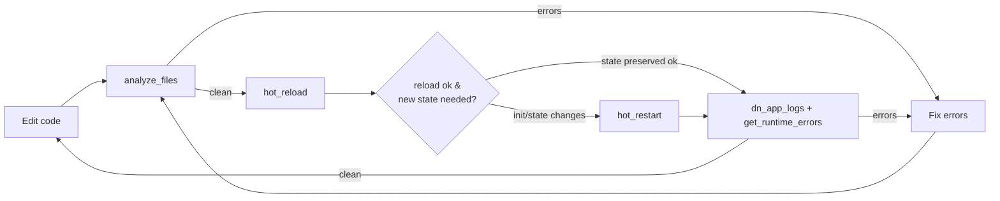

# Running a Project on the iOS/Android Simulator — End-to-End Workflow

This guide is the complete "launch and iterate" loop: discover the MCP tools,
analyze the project, resolve dependencies, pick an iOS or Android
simulator/device with `dn_devices`, launch with `dn_run`, confirm the debugger
attached, and then iterate with `hot_reload` / `hot_restart`.

---

## 0. Discover the Related MCP Tools

Before starting, confirm which `dartnative` server tools are available in the
session. The relevant set for this workflow:

| Tool | Role in this workflow |
| :--- | :--- |
| `analyze_files` (or `dn_analyze`) | Static analysis; detects missing dependencies |
| `pub` (`command: "get"`) | Resolves missing package dependencies |
| `dn_devices` | Lists devices, simulators, and emulators |
| `dn_run` | Launches the app on the chosen device |
| `dn_app_logs` | Reads startup/runtime output of the launched app |
| `dtd` | Discovers/connects to the Dart Tooling Daemon (the debugger host) |
| `vm_service` | Fallback debugger attach when DTD discovery is unavailable |
| `hot_reload`, `hot_restart` | Iterate on the running app |
| `dn_screenshot` | Captures the device screen or the app through the debugger |
| `get_runtime_errors` | Reads runtime exceptions after launch/reload |
| `dn_stop_app` | Stops the app when the session is finished |

If the tools are not listed, the `dartnative` MCP server may not be running or
the DartNative SDK could not be found. Run `dn doctor` diagnostics via
`dn_doctor` first.

---

## 1. Analyze the Project First

**`analyze_files` must be the first action** taken on the project. It surfaces
syntax errors, unresolved imports, and — importantly for this workflow —
missing dependencies.

- If analysis reports missing packages (e.g. `uri_does_not_exist`,
  unresolved `package:` imports), call `pub` with `"command": "get"` and then
  **re-run `analyze_files`**. Do not launch an app on a broken analysis; the
  build on the simulator would only fail later with far less readable output.
- If simple lints remain, prefer `dart_fix` / `analyze_files` with
  `applyFixes: true`. See [`analysis_and_formatting.md`](./analysis_and_formatting.md).

---

## 2. Check Available Devices (`dn_devices`)

Call `dn_devices` (no parameters) and read the device list it returns. Each
entry has a device **ID** that `dn_run` targets, technology, and platform.

Decision rules:

- **iOS simulator or Android emulator present** → pick that device ID and
  continue to step 3. This is the normal fast-iteration path.
- **Only a physical device is connected** → it is also a valid `dn run`
  target; use its ID with the same workflow.
- **No devices found** → stop and report. Suggest the user start a simulator
  (iOS Simulator app / Xcode) or an Android emulator (Android Studio /
  `avdmanager`). Re-run `dn_devices` after a device becomes available.
- If device selection is ambiguous (several simulators running), prefer the
  one matching the platform the user asked for; otherwise ask the user which
  device ID to use rather than guessing.

**Important**: `dn_run` does not accept a platform name such as `ios` or
`android` directly — it requires the concrete device **ID** from the
`dn_devices` output.

---

## 3. Launch the App (`dn_run`)

**Required pre-build gate: check the fast path before calling `dn_run`.** Read
[`fast_run_without_build.md`](./fast_run_without_build.md) and verify whether a
compatible prebuilt debug binary exists. Do not default to a full build just
because it is the simplest tool call.

### Tell the user the mode before starting

Before the `dn_run` call, send a short status update stating the selected mode
and why:

- **Fast launch:** “I found a compatible debug binary for this simulator; I’ll
  reuse it and skip the native build.”
- **Full build:** “I’m doing a full iOS build because [no compatible simulator
  binary exists / native or CocoaPods inputs changed / compatibility could not
  be verified]. This will take longer than reusing a binary.”

Do not present an unverified artifact as compatible. Ask the user before
proceeding if the intended app root, device, flavor, or build choice is
ambiguous and cannot be resolved from the project and request. Otherwise state
the evidence and continue with the safe mode.

First resolve the correct project root and target:

- `root` must be the project directory containing the native platform scaffold
  for this launch (for example, `ios/Runner` for iOS), not necessarily the Dart
  package directory containing `main.dart`.
- Set `target` to the entrypoint path **relative to that root**. For an example
  package without its own `ios/` or `android/` scaffold, use the enclosing app
  root and the example's relative entrypoint. Check for the scaffold before
  launching; do not probe candidate roots with repeated failing builds.

Then check binary compatibility before choosing the launch mode:

1. **Exists and is debuggable:** the artifact must exist and be a debug build
   (hot reload is not supported by profile/release builds).
2. **Matches the requested target:** it must be built for the requested OS,
   device class, and architecture. In particular, an iOS Simulator `.app` is
   not interchangeable with an iOS-device `Runner.app`/IPA; an Android build
   must match the device ABI and intended variant/flavor.
3. **Matches this app configuration:** verify it belongs to this project/root
   and the intended flavor/bundle identity, rather than another app or
   workspace package.
4. **Native inputs are no newer than the artifact:** compare the artifact's
   build time with relevant native inputs, including platform project/source
   files, plugin registrants/lockfiles, `pubspec.yaml`/`pubspec.lock`, and
   local or hosted native plugin dependencies. Use the checks in
   `fast_run_without_build.md`; if compatibility or freshness is uncertain,
   do a full build and say which check failed or could not be verified.

If all checks pass, pass the binary through `useApplicationBinary`. When the
dependency graph is also known unchanged, `arguments: ["--no-pub"]` can avoid
an unnecessary package resolution. Otherwise let `dn` resolve packages. For a
Dart-only update, do not rebuild native code just to deliver the Dart change;
launch the compatible binary and then hot-reload/restart as appropriate.

Call `dn_run` with:

| Parameter | Required | Notes |
| :--- | :--- | :--- |
| `root` | **Yes** | Project root as a `file:` URI |
| `device` | **Yes** | Device ID from `dn_devices` (iOS simulator / Android emulator) |
| `target` | No | Entrypoint file, e.g. `lib/main.dart`; defaults to the project default (usually `bin/main.dart`) |
| `arguments` | No | Extra `dn run` flags, e.g. `["--dart-define=KEY=value"]`, `--flavor`, `--debug`, `--profile`, `--release`. Managed flags (`-d`, `-t`, `--machine`, `--pid-file`, `--vmservice-out-file`, `--use-application-binary`) are rejected — use `device`/`target` instead |
| `useApplicationBinary` | No | Existing compatible debug APK/IPA/`.app`; required to take the fast path and skip a fresh build. See the pre-build gate above. |
| `timeout` | No | Milliseconds to wait for startup readiness. Default is `90000`. Raise it (e.g. `300000`) for a first build or a cold simulator |

`dn_run` is **asynchronous**: it starts the `dn run` process, monitors stdout,
returns as soon as the app reports startup readiness (or an error), and keeps
the process alive.

Interpreting the result:

- `ready: true` → the app started. The result includes `pid` (needed for
  `dn_app_logs` and `dn_stop_app`) and startup `logs`.
- `ready: false` with `exited: true` → the app exited during startup. Read the
  returned `logs` — they contain the concrete failure (build error, install
  failure, missing device). Fix the reported problem and retry.
- `ready: false` with a timeout message → the process is **still running**
  (e.g. a slow first build). Poll `dn_app_logs` with the returned `pid` until
  readiness lines appear or a failure shows up. Do not relaunch while a run is
  in progress — call `dn_stop_app` first if you need to restart.

When a full build is necessary, record the reason (no binary, incompatible
device target, or stale/uncertain native inputs) and the build duration from
the `dn_run` output when available. This makes it clear whether a later launch
can use the prebuilt-binary path.

### Automatically attach the IDE debugger

After `dn_run` reports `ready: true`, the MCP server returns the VM Service URI
and automatically attempts the IDE attach. It reads
`.dart_tool/dartnative_dtd.json` from the app root and sends the
`Editor.attachToVmService` DTD request. Check the `ideAttach` field in the
`dn_run` result and report whether the IDE accepted the attach. Do not run a
Python script or manually read/copy the descriptor capability.

- A missing descriptor is non-fatal: the app remains connected to the MCP
  server's VM Service, but no IDE attach was requested. To enable IDE attach,
  open this project in an IDE that publishes the descriptor and retry.
- Treat the descriptor's `capability` and the VM Service URI as credentials.
  Do not log or repeat the capability; use the `attach_ide_debugger` MCP tool
  for manual attaches.
- For an app launched outside `dn_run`, call `attach_ide_debugger` with its
  project root and VM Service URI (for example, copied from that run's VM
  Service startup log). If the URI is omitted, the MCP tool can discover it
  only when the IDE DTD reports exactly one registered VM service. If there
  are multiple, select one explicitly; if there are none, DTD cannot infer the
  URI of an unregistered process.
- The tool validates that both DTD and VM Service endpoints are local. A stale
  descriptor or unsupported `Editor.attachToVmService` request should be
  reported as an attach failure, not as an app-build failure.

Readiness is detected on lines such as `Dart VM Service`,
`Syncing files to device`, and `is available at:`. Failures such as
`Could not build`, `Failed to install`, `No devices found`, or
`Error launching application` end the wait with an error.

### CocoaPods/native-plugin recovery

Treat these as actionable iOS CocoaPods/native-linkage signals, even when
`ready: true` and the app appears to launch:

- Logs explicitly recommend `pod install` in `ios/` or say native plugin
  symbols are absent from the build.
- Plugin FFI lookup fails with `symbol not found` / `dlsym` for an iOS plugin
  symbol, or the Xcode build reports missing pods/frameworks/linker inputs.

For example, `its native symbols are not in this build` followed by a failed
`dlsym` lookup means that plugin will not work in the running binary; it is not
just an ignorable warning.

Recovery sequence:

1. Tell the user that the app started but native plugin integration is
   incomplete, and that CocoaPods installation plus a full native rebuild is
   needed.
2. If an app process is running, stop it with `dn_stop_app` before replacing
   the installed app. Resolve the app root that owns `ios/` (not necessarily
   the Dart entrypoint package directory).
3. Run `pod install` with the working directory set to that root's `ios/`
   directory. There is no DartNative MCP pod-install tool; use the shell only
   for this required CocoaPods command. Do not run it from the repository root,
   delete `Podfile.lock`/`Pods`, or use `pod update` as an automatic retry.
4. If `pod install` succeeds, run `dn_run` again from the app root **without**
   `useApplicationBinary`. Pod/lockfile changes make the previous native
   artifact stale; this retry must perform a full build.
5. Read the new startup logs (and runtime errors when available). Confirm the
   prior missing-symbol/pod errors are gone before saying they were fixed. If
   `pod install` or the rebuild fails, report the failing output and stop—do
   not loop retries or claim recovery.

Include the recovery (pod install + full rebuild) in the final summary and
measure elapsed time across the recovery-to-ready sequence as well as any
individual durations reported by CocoaPods/Xcode.

## 4. Wait for & Verify the Debugger Attach

When `dn run` makes the app debuggable, the MCP server captures the app's
**DTD URI** and/or **VM Service URI** from the startup output and connects to
them **automatically**. The `dn_run` result reflects this two ways:

- The summary contains `dtdUri` and/or `vmServiceUri` fields.
- The closing text says the app's DTD and/or VM service URI "has been
  connected automatically".

Verification options, in order of cost:

1. Often unnecessary: if `dtdUri`/`vmServiceUri` are in the result, the
   debugger is attached — continue to the launch report below, then step 5.
2. Confirm with `dtd` `command: "listConnectedApps"`. The app appears under
   the connected DTD (or as a standalone VM service app).
3. If nothing is connected yet (startup was still in flight when `dn_run`
   returned): re-check `dn_app_logs`; once a URI line has been printed, the
   next `listConnectedApps` (or any app tool call) will trigger the
   auto-attach. A short re-poll is all that is needed.

**Fallback — manual attach.** If the result contains no URIs and
`listConnectedApps` stays empty (older SDK without DTD discovery, or the URI
was cut from the log tail):

- If `dn_app_logs` shows a VM Service URI
  (`ws://127.0.0.1:PORT/TOKEN=/ws`): call `vm_service` with
  `command: "connect"` and `appUri: "<VM Service URI>"`.
- Otherwise call `dtd` with `command: "listDtdUris"`, then `connect` with the
  chosen `uri` — prefer an instance whose working directory is this project.

### Measure and report the result

Measure wall-clock time around the awaited `dn_run` call. When using `execute`,
wrap the call with `Date.now()` so the duration is available even if the MCP
result omits it; use Xcode/`dn`'s reported build duration as the compile-time
breakdown when present. For CocoaPods recovery, also report the combined time
from starting `pod install` through app readiness if measurable. Never infer a
precise duration from the logs; if timing could not be captured, say so.

Example timing wrapper when calling the MCP tool through Code Mode:

```js
const startedAt = Date.now();
const result = await tools.dartnative.dn_run({
  root: "file:///path/to/app",
  device: "<device-id>",
  target: "lib/main.dart",
});
return { elapsedMs: Date.now() - startedAt, result };
```

After a successful app launch, get `dn_app_logs` if the returned startup tail
does not include the service lines. Copy the URLs exactly—do not reconstruct
tokens or invent paths. Report the device name, total elapsed time from
operation start to app readiness, and the Xcode-reported compile time when
available. Include the `ideAttach` status from `dn_run` (attached, skipped, or
failed, with the reason). For fast launch, state that the native build was
skipped and give launch time instead. Keep the full-build/fast-launch summary to **one simple
line**, for example `Fast launch — reused the iPhone 12 Pro simulator debug
binary` or `Full build — rebuilt the iPhone 12 Pro simulator app after pod
install`.

For URLs, use the WebSocket VM Service endpoint from this run in **one
URL-only fenced code block** to provide a copy button. Do not repeat that URL
elsewhere in the response. Render the DevTools debugger URL as a Markdown link.
Do not use a URL from a previous app process.

For `dn_build` without app launch, VM Service and debugger URLs are not
applicable; say that rather than implying a debugger is attached.

Use this concise completion format for app launches:

<Full build or Fast launch> — <short reason>
Device: <exact name from dn_devices>
Time: <total wall-clock from operation start to ready>; Xcode build: <reported compile duration or n/a>
VM Service URL:
```text
<exact WebSocket VM Service URL from this run>
```
Debugger: [Open DartNative debugger](<exact DevTools URL from this run>)
IDE attach: <attached, skipped, or failed; briefly explain>
Recovery: <none, or issue → action → verified result>

---

## 5. Iterate: Hot Reload & Hot Restart

With the debugger attached, verification of each code change is a two-step
loop:



- `hot_reload` — after widget build/layout/styling/logic changes. Supports
  `clearRuntimeErrors: true` to drop stale errors from the previous run.
- `hot_restart` — after changes to `main()`, `initState`/`dispose`, global or
  static state, or const top-level values. Reruns `main()`; state is lost.
- Both accept `appUri` — **required when more than one app is connected**
  (e.g. an IDE-launched app plus this one). Get the exact URI from
  `dtd` `listConnectedApps`.
- After each reload/restart, check `get_runtime_errors` (optionally with
  `clearRuntimeErrors: true`) and `dn_app_logs` for fresh output.

If a hot reload fails repeatedly, prefer `hot_restart`; if restart also fails,
`dn_stop_app` the `pid` and relaunch with `dn_run`.

---

## 6. Shutdown

When the debugging session is finished, call `dn_stop_app` with the `pid` from
`dn_run` to free the device and stop the background process.

---

## Quick Reference (condensed call sequence)

```text
1. analyze_files                              → clean? continue. missing deps?
2. pub { command: "get" }                    → then re-analyze
3. dn_devices                                 → choose requested device ID
4. Resolve root/target; check binary compatibility; tell user full vs fast mode
5. Start timer; dn_run { root, device, target?, useApplicationBinary? }
                                               → ready:true, pid, app URLs
6. Read logs/verify debugger; report mode, elapsed time, VM + DevTools URLs,
   and any verified recovery
7. edit → analyze → hot_reload / hot_restart → get_runtime_errors + dn_app_logs
8. dn_stop_app { pid }
```
